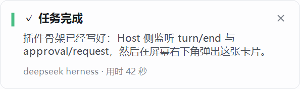

# 桌面弹窗提醒（dsh-desktop-notify）

[English](#english) | 简体中文

DSH 窗口被最小化、被别的窗口盖住、或者你正在别的程序里时，任务结束或需要你介入的那一刻，
屏幕右下角会浮起一张小卡片——就是聊天软件收到消息时的那种提示。



## 什么时候弹

| 时机 | 触发来源 | 卡片 |
| --- | --- | --- |
| 一轮正常结束 | `turn/end: completed` | 绿色竖条 ·「✓ 任务完成」 |
| 一轮出错 | `turn/end: error` | 红色竖条 ·「！任务出错」 |
| 输出被截断 / 被阻止 / 会话中断 / 被中止 | 对应的 `turn/end` 原因 | 灰色竖条 |
| 工具等待你授权 | `approval/request` | 琥珀竖条 ·「⚠ 需要你的确认」，正文带工具名与原因 |
| Agent 向你提问 | `user-questions/request` | 琥珀竖条 ·「？需要你回答」，正文带问题 |

完成卡片显示这一轮最后一段回复（截断为一行），出错卡片显示错误码或错误信息，
底部显示会话标题与实际耗时。

## 什么时候不弹

- **前台窗口属于 DeepSeek Harness**：你正看着它，不需要提醒。这项检查在渲染之前完成，
  此时只是短暂启动一个 PowerShell 进程后立刻退出，屏幕上不会闪任何东西。
- **子代理（subagent）会话**的回合结束，避免一次任务弹出一串提示。
- **你自己点停的那一轮**（中止原因为 `user`）。
- `enabled` 关闭，或当前不是 Windows。

## 卡片行为

- 固定在主屏右下角，始终置顶，**不抢焦点**，不出现在 Alt+Tab 和任务栏里，不影响你正在打的字。
- 从屏幕右侧滑入（约 220ms，缓出曲线），`animate: false` 可变成原地出现。
- 显示后会把自己推到置顶窗口队列的最前面，并在卡片存活期间每 0.8 秒重申一次，
  所以别的窗口（包括同样置顶的窗口）后激活也压不住它。真正全屏独占的程序（部分游戏）无法覆盖。
- 完成卡片默认停留 12 秒，等待你操作的卡片停留 24 秒，然后自己消失。
- **右上角的 ✕**：只关闭卡片，不切换窗口；鼠标移上去会高亮并变成手型光标。
- **单击卡片其他位置**：关闭卡片并把 Harness 窗口叫回前台（最小化会自动还原）。
- 新卡片会替换上一张，不会叠成一摞。
- 颜色跟随 Windows 的浅色/深色设置，用绿、琥珀、红、灰四种竖条区分结果。
- 默认播放系统提示音（完成、等待、出错各用一种），`silent: true` 可关。

## 配置

在 `cordis.patch.yml` 里改 `desktop-notify` 这一行的 `config`：

| 键 | 默认值 | 说明 |
| --- | --- | --- |
| `enabled` | `true` | 总开关 |
| `notifyOnTurnEnd` | `true` | 任务完成时提醒 |
| `notifyOnError` | `true` | 任务出错时提醒 |
| `notifyOnApproval` | `true` | 需要授权时提醒 |
| `notifyOnQuestion` | `true` | 需要回答时提醒 |
| `notifyWhenFocused` | `false` | 窗口在前台也提醒；仅用于检查卡片长什么样 |
| `silent` | `false` | 不播放提示音 |
| `animate` | `true` | 从右侧滑入；设为 `false` 则原地出现 |
| `cardDurationMs` | `12000` | 完成卡片停留时长（毫秒） |
| `waitingDurationMs` | `24000` | 等待你操作的卡片停留时长（毫秒） |
| `summaryChars` | `90` | 正文摘要最大字数 |
| `appProcessName` | `DeepSeek Harness` | 判定「窗口在前台」用的进程名 |
| `language` | `zh` | 卡片文案语言，`zh` 或 `en` |
| `logFile` | 空 | 写入卡片诊断日志的路径，排错时用 |

## 为什么不是系统通知中心的通知

Windows 的 toast 接口要求调用进程有「程序包身份」，普通桌面进程调用会失败并返回
`0x80073D54`。所以这里用 PowerShell + WinForms 自己画一张卡片：任何 Windows 10/11 都能显示，
外观也完全可控。代价是**通知不会留在通知中心**，关掉就没了。

## 排错

每次调用都会在 `%TEMP%\dsh-desktop-notify.log` 留一行记录（超过 200 KB 自动重来），用它可以分清三种情况：

- `invoked ...` —— 插件确实触发了；
- `foreground=... name=DeepSeek Harness` 加 `skipped: harness window is foreground` —— 窗口在前台，按设计不打扰；
- `showing card ... painted` —— 卡片已经画出来了；
- `raised to top ok=True style=... topmost=True` —— 卡片确实在置顶层（`topmost=False` 说明没进置顶层，会被普通窗口压住）；
- `bounds=... above us: [...]` —— 卡片位置和压在它上面的窗口，排查遮挡时看这一行。

想固定日志位置就把配置里的 `logFile` 指向一个路径。

## 已知限制

- 仅 Windows；其他平台插件保持静默。
- 卡片只出现在主屏右下角。
- 卡片由一次性 PowerShell 进程绘制，事件到出现之间约有 0.3–0.6 秒延迟，并在显示期间保留该进程。
- 回复过长时正文只显示前四行。
- 停用插件后立即不再提醒；已经显示的卡片不受影响，会在超时后消失。

---

## English

A Windows-only DeepSeek Harness plugin: when a turn finishes, fails, or the Harness is waiting for
your approval or answer **while its window is not in front**, a small card slides into the bottom-right
corner of the primary screen — the same pattern chat apps use for incoming messages.


### Install

In the Web GUI open **Plugins → Add plugin**, enter the Git address
`github:xiaoweiqianluo/dsh-desktop-notify` (or clone the repository and give its absolute path),
then enable **Desktop popup alerts** in the plugin list.

Or from a shell with the `dsh` CLI available:

```powershell
dsh plugin --profile desktop add github:xiaoweiqianluo/dsh-desktop-notify
```

No dependencies, no build step: the bundle is plain ES module JavaScript plus one PowerShell script.
It needs Windows 10/11 with Windows PowerShell 5.1 (installed by default).

### When it appears

| Moment | Source | Card |
| --- | --- | --- |
| A turn completed | `turn/end: completed` | Green bar · "✓ Task finished" |
| A turn failed | `turn/end: error` | Red bar · "! Task failed" |
| Output truncated / blocked / interrupted / stopped | the matching `turn/end` reason | Grey bar |
| A tool waits for authorization | `approval/request` | Amber bar · "⚠ Your confirmation is needed" |
| The agent asks a question | `user-questions/request` | Amber bar · "? Your answer is needed" |

It stays silent when the foreground window belongs to the Harness (you are already looking at it),
for subagent sessions, and for turns you stopped yourself.

### Card behavior

- Always on top of the topmost band, **never takes focus**, never shows in Alt+Tab or the taskbar.
- Slides in from the right (~220 ms, ease-out); `animate: false` shows it in place.
- The **✕ in the top-right corner** closes the card without switching windows; hovering highlights it.
- Clicking anywhere else closes the card and brings the Harness window back (restoring it if minimized).
- The ✕/click split, per-kind accent colours and fonts are drawn with WinForms and follow the Windows
  light/dark setting. Completion cards live 12 s, waiting cards 24 s.

### Configuration

Edit the `desktop-notify` row in `cordis.patch.yml`:

| Key | Default | Meaning |
| --- | --- | --- |
| `enabled` | `true` | Master switch |
| `notifyOnTurnEnd` | `true` | Card when a turn completes |
| `notifyOnError` | `true` | Card when a turn fails |
| `notifyOnApproval` | `true` | Card when an authorization is pending |
| `notifyOnQuestion` | `true` | Card when the agent asks a question |
| `notifyWhenFocused` | `false` | Also alert while focused; for inspecting the card |
| `silent` | `false` | No system sound |
| `animate` | `true` | Slide in from the right |
| `cardDurationMs` | `12000` | Completion card lifetime |
| `waitingDurationMs` | `24000` | Waiting card lifetime |
| `summaryChars` | `90` | Maximum preview characters |
| `appProcessName` | `DeepSeek Harness` | Process name treated as "window in front" |
| `language` | `zh` | Card copy language, `zh` or `en` |
| `logFile` | empty | Optional diagnostics log path |

### Why not a Windows toast

The toast API requires package identity; an ordinary desktop process calling it fails with
`0x80073D54`. This plugin draws its own card with PowerShell and WinForms instead, which works on
every Windows 10/11 installation and keeps the appearance under control. The trade-off: notifications
are **not kept in the Action Center**.

### Known limitations

- Windows only; the plugin stays silent elsewhere.
- The card only appears on the primary screen.
- A one-shot PowerShell process draws the card: expect 0.3–0.6 s between event and appearance.
- A long reply is clamped to four lines.
- A card already on screen closes on its timeout after the plugin is disabled.

